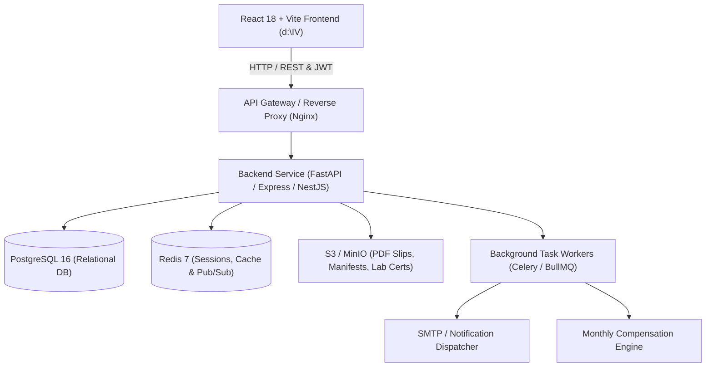
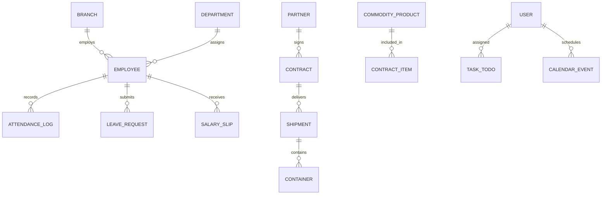

# SOILEX Life Science — Backend & REST API Specification

This document provides a comprehensive backend architecture, relational database schema, and REST API specification covering all **20 enterprise modules** of **SOILEX Life Science**. It is designed to guide backend engineers in building production APIs (Node.js/Express, Python/FastAPI, or Go) and database tables that seamlessly integrate with the frontend application in `d:\IV`.

---

## 1. System Architecture & Tech Stack Recommendation



### Recommended Backend Stack:
* **API Framework**: **Python FastAPI** or **Node.js (NestJS / Express)**
* **Primary Database**: **PostgreSQL 16** (Supports relational integrity, JSONB metadata for lab parameters, and full-text search)
* **ORM**: **Prisma** (Node.js) or **SQLAlchemy 2.0 / Tortoise ORM** (Python)
* **Authentication**: **JWT** (Access Tokens 15m, Refresh Tokens 7d in HttpOnly cookie) + **RBAC**
* **File Storage**: **AWS S3 / Cloudflare R2 / MinIO** (for storage of PDF salary slips, bills of lading, and FSSAI certificates)
* **Real-time Engine**: **WebSockets** (Socket.io or native WebSockets) for live container updates and attendance logging.

---

## 2. Global Standards & Conventions

### Base URL:
```
https://api.soilexlifescience.com/api/v1
```

### Standard Headers:
```http
Authorization: Bearer <jwt_access_token>
Content-Type: application/json
Accept: application/json
X-Facility-Code: BR-HN
```

### Standard Response Envelope:
```json
{
  "success": true,
  "statusCode": 200,
  "message": "Operation completed successfully",
  "data": {},
  "timestamp": "2026-09-05T14:55:00.000Z"
}
```

### Standard Error Envelope:
```json
{
  "success": false,
  "statusCode": 400,
  "errorCode": "VALIDATION_FAILED",
  "message": "Invalid commodity volume specified",
  "errors": [
    { "field": "stockMT", "issue": "Must be greater than 0" }
  ],
  "timestamp": "2026-09-05T14:55:00.000Z"
}
```

---

## 3. Database Schema Overview (Entity Relationship)



---

## 4. Module-by-Module API Specifications

---

### Module 1: Dashboard & Analytics (`Main/`)
* **Frontend Component**: `src/components/dashboard/MainDashboard.jsx`
* **Mockup Location**: `reference_mockups/Main/`

#### 1.1 Get Executive Dashboard Summary
* **`GET /dashboard/executive-summary`**
* **Auth**: Required (Admin, Executive, Manager)
* **Query Params**: `?year=2026&category=ALL`
* **Response (200 OK)**:
```json
{
  "success": true,
  "data": {
    "salesOrders": {
      "bogApprovalPending": 6,
      "awaitingBuyerSign": 2,
      "orderInProcess": 99,
      "completed": 8
    },
    "salesContract": {
      "mtdRevenueUSD": 0.00,
      "ytdRevenueUSD": 7000000.00,
      "ytdVolumeCBM": 20892.32,
      "ytdVolumeMT": 1784.16
    },
    "salesInvoice": {
      "mtdRevenueUSD": 0.00,
      "ytdRevenueUSD": 1300000.00,
      "ytdVolumeCBM": 6076.50
    },
    "purchaseOrders": {
      "bogApprovalPending": 28,
      "approved": 265,
      "paymentPending": 207
    },
    "totalPurchase": {
      "ytdVolumeVND": 1312200000000,
      "ytdVolumeCBM": 615420.29
    },
    "containers": {
      "totalOrders": 500,
      "pendingCustoms": 425,
      "loaded": 75
    },
    "partnersCount": {
      "registeredBuyers": 34,
      "qualifiedSuppliers": 56
    },
    "productsCount": 21,
    "receivablesUSD": 0.00,
    "payablesVND": 1312200000000
  }
}
```

---

### Module 2: Spices & Agro Product Catalog (`Products/`)
* **Frontend Component**: `src/components/products/ProductCatalog.jsx`
* **Mockup Location**: `reference_mockups/Products/`

#### 2.1 List All Products
* **`GET /products`**
* **Query Params**: `?category=Whole%20Spices&search=Pepper&page=1&limit=20`
* **Response (200 OK)**:
```json
{
  "success": true,
  "data": {
    "items": [
      {
        "id": "SP-002",
        "name": "Black Pepper 550 G/L",
        "category": "Whole Spices",
        "grade": "Export Quality",
        "origin": "Kerala / Vietnam",
        "stockMT": 420.0,
        "priceMT": 6400.00,
        "packaging": "50kg PP Bag",
        "status": "In Stock"
      }
    ],
    "total": 21,
    "page": 1,
    "limit": 20
  }
}
```

#### 2.2 Create New Product SKU
* **`POST /products`**
* **Request Payload**:
```json
{
  "name": "Clove Whole Lal Pari",
  "category": "Whole Spices",
  "grade": "Handpicked CG3",
  "origin": "Madagascar / India",
  "stockMT": 150.0,
  "priceMT": 8200.00,
  "packaging": "25kg Carton",
  "moisturePercentage": 11.5,
  "certification": "ISO, FSSAI"
}
```
* **Response (201 Created)**: Returns created product with generated ID.

---

### Module 3: Global Trade & Export Operations (`Export/` & `Import/`)
* **Frontend Component**: `src/components/trade/TradeView.jsx`
* **Mockup Location**: `reference_mockups/Export/`, `reference_mockups/Import/`

#### 3.1 List Active Container Consignments
* **`GET /trade/shipments?type=export&status=IN_TRANSIT`**
* **Response (200 OK)**:
```json
{
  "success": true,
  "data": [
    {
      "id": "SOLEX-EXP-001",
      "buyerId": "BYR-102",
      "buyerName": "TRANS-PACIFIC FOODS LLC",
      "originPort": "Nhava Sheva, India",
      "destinationPort": "Port of Long Beach, USA",
      "volumeCBM": 1240.0,
      "containerCountFCL": 12,
      "status": "IN_TRANSIT",
      "vesselName": "MSC VALERIA",
      "billOfLadingNo": "BL-2026-9912",
      "eta": "2026-09-18T00:00:00Z"
    }
  ]
}
```

#### 3.2 Create Bill of Lading
* **`POST /trade/shipments/:id/bill-of-lading`**
* **Request Payload**:
```json
{
  "shippingLine": "Maersk Line",
  "containerNumbers": ["MSKU9021841", "MSKU9021842"],
  "grossWeightMT": 284.5,
  "sealNumbers": ["SL-9941", "SL-9942"],
  "temperatureControlledCelsius": 18.0
}
```

---

### Module 4: Buyers, Suppliers & Brokers (`Buyers/`, `Suppliers/`, `Brokers/`)
* **Frontend Component**: `src/components/partners/PartnersView.jsx`
* **Mockup Location**: `reference_mockups/Buyers/`, `Suppliers/`, `Brokers/`

#### 4.1 List Partners by Type
* **`GET /partners?type=buyers`** (`type=buyers | suppliers | brokers`)
* **Response (200 OK)**:
```json
{
  "success": true,
  "data": [
    {
      "id": "BYR-101",
      "name": "GLOBAL SPICES IMPEX GMBH",
      "partnerType": "buyer",
      "country": "Germany",
      "destinationPort": "Hamburg Port",
      "contactPerson": "Klaus Schmidt",
      "email": "orders@globalspices.de",
      "phone": "+49 40 82910",
      "annualVolumeCBM": "3,400 CBM",
      "creditTerms": "LC 60 Days",
      "creditRating": 4.9,
      "kycStatus": "VERIFIED"
    }
  ]
}
```

---

### Module 5: Real-Time Scientific Calendar (`MY CALENDER/`)
* **Frontend Component**: `src/components/calendar/RealtimeCalendar.jsx`
* **Mockup Location**: `reference_mockups/MY CALENDER/`

#### 5.1 Fetch Calendar Events by Month Range
* **`GET /calendar/events?year=2026&month=9`**
* **Response (200 OK)**:
```json
{
  "success": true,
  "data": [
    {
      "id": 1,
      "title": "Container Loading (12 FCL Anise Cigar)",
      "startDate": "2026-09-02T09:00:00Z",
      "endDate": "2026-09-02T12:00:00Z",
      "category": "Shipment",
      "location": "Warehouse Dock 4",
      "description": "Loading 12 containers destined for Hamburg port.",
      "status": "CONFIRMED"
    },
    {
      "id": 2,
      "title": "ISO 22000 & HACCP Audit Inspection",
      "startDate": "2026-09-05T11:30:00Z",
      "endDate": "2026-09-05T14:30:00Z",
      "category": "Compliance",
      "location": "Bio-Hub QA Lab",
      "description": "Annual certification review."
    }
  ]
}
```

#### 5.2 Create New Calendar Event
* **`POST /calendar/events`**
* **Request Payload**:
```json
{
  "title": "Perfumed Rice DT 8 Quality Sampling",
  "startDate": "2026-09-14T10:00:00Z",
  "endDate": "2026-09-14T11:30:00Z",
  "category": "Agro",
  "location": "Milling & Testing Center",
  "description": "Moisture and aroma testing before bulk bagging."
}
```

---

### Module 6: Employee Directory & Profiles (`EMPLOYEE/`)
* **Frontend Component**: `src/components/employees/EmployeeList.jsx`
* **Mockup Location**: `reference_mockups/EMPLOYEE/`

#### 6.1 List Employees with Pagination & Filter
* **`GET /employees?page=1&limit=10&search=Kumar`**
* **Response (200 OK)**:
```json
{
  "success": true,
  "data": {
    "items": [
      {
        "id": 1,
        "employeeCode": "EMPL000001",
        "name": "DR. S KUMAR",
        "branch": "SOLEX BIO-HUB HN",
        "designation": "CHIEF EXECUTIVE OFFICER",
        "department": "EXECUTIVE BOARD",
        "bloodGroup": "O+",
        "gender": "MALE",
        "shift": "MORNING",
        "status": "ACTIVE"
      }
    ],
    "total": 10
  }
}
```

---

### Module 7: HR Workforce & Attendance Gauge (`HR Dashboard/`)
* **Frontend Component**: `src/components/hr/HrDashboard.jsx`
* **Mockup Location**: `reference_mockups/HR Dashboard/`

#### 7.1 Get Daily Attendance Distribution & Roster
* **`GET /hr/roster-today`**
* **Response (200 OK)**:
```json
{
  "success": true,
  "data": {
    "metrics": {
      "present": 8,
      "absent": 1,
      "onLeave": 1
    },
    "staff": [
      {
        "initials": "VT",
        "name": "VŨ THỊ HOAN",
        "code": "EMPL000036",
        "role": "COMMERCIAL SALES EXECUTIVE",
        "facility": "SOLEX HA NOI BIO-HUB",
        "status": "PRESENT"
      }
    ]
  }
}
```

---

### Module 8: Attendance & Leave Master (`Attendance/`)
* **Frontend Component**: `src/components/attendance/AttendanceView.jsx`
* **Mockup Location**: `reference_mockups/Attendance/`

#### 8.1 Biometric Clock In / Clock Out
* **`POST /attendance/clock`**
* **Request Payload**:
```json
{
  "employeeCode": "EMPL000036",
  "action": "CLOCK_IN",
  "deviceType": "BIOMETRIC_OR_WEB",
  "latitude": 21.0285,
  "longitude": 105.8542
}
```

#### 8.2 Submit Leave Application
* **`POST /attendance/leaves`**
* **Request Payload**:
```json
{
  "employeeCode": "EMPL000036",
  "leaveType": "Casual Leave (CL)",
  "startDate": "2026-09-10",
  "endDate": "2026-09-12",
  "reason": "Family engagement"
}
```

---

### Module 9: Payroll & Compensation (`payroll/`)
* **Frontend Component**: `src/components/payroll/PayrollView.jsx`
* **Mockup Location**: `reference_mockups/payroll/`

#### 9.1 Get Monthly Payroll Run Summary
* **`GET /payroll/runs?cycle=2026-08`**
* **Response (200 OK)**:
```json
{
  "success": true,
  "data": {
    "totalGrossUSD": 47900.00,
    "totalDeductionsUSD": 4150.00,
    "totalNetUSD": 43750.00,
    "status": "COMPLETED",
    "slips": [
      {
        "employeeCode": "EMPL000001",
        "name": "DR. S KUMAR",
        "gross": 14500.00,
        "deductions": 1200.00,
        "net": 13300.00,
        "bankName": "Standard Chartered",
        "payoutStatus": "DISBURSED",
        "slipDownloadUrl": "https://api.soilexlifescience.com/slips/2026-08/EMPL000001.pdf"
      }
    ]
  }
}
```

---

### Module 10: Task Boards & My Day Planner (`TODO DASHBOARD/` & `MY DAY/`)
* **Frontend Component**: `src/components/workspace/TodoPlanner.jsx`
* **Mockup Location**: `reference_mockups/TODO DASHBOARD/`, `reference_mockups/MY DAY/`

#### 10.1 List Tasks
* **`GET /tasks?isMyDay=true`**
* **Response (200 OK)**:
```json
{
  "success": true,
  "data": [
    {
      "id": 1,
      "title": "Inspect Anise Cigar Batch at Dock 4",
      "priority": "High",
      "status": "In Progress",
      "dueDate": "2026-09-05T15:00:00Z",
      "category": "Logistics"
    }
  ]
}
```

#### 10.2 Toggle Task Completion
* **`PATCH /tasks/:id`**
* **Request Payload**: `{ "status": "Completed" }`

---

### Module 11: Business Intelligence & Reports (`Report/`)
* **Frontend Component**: `src/components/analytics/ReportsView.jsx`
* **Mockup Location**: `reference_mockups/Report/`

#### 11.1 Get Commodity Export Report
* **`GET /reports/export-revenue?fiscalYear=2026`**
* **Response (200 OK)**:
```json
{
  "success": true,
  "data": {
    "totalRevenueUSD": 13700000.00,
    "yoyGrowth": "+16.4%",
    "breakdown": [
      {
        "commodity": "Whole Spices (Anise, Pepper, Cardamom)",
        "volumeMT": 1784.0,
        "revenueUSD": 7040000.00,
        "yoyGrowth": "+18%"
      }
    ]
  }
}
```

---

### Module 12: Client Meetings & Trade Audits (`Visits/`)
* **Frontend Component**: `src/components/analytics/ReportsView.jsx`
* **Mockup Location**: `reference_mockups/Visits/`

#### 12.1 Log Client Visit
* **`POST /visits`**
* **Request Payload**:
```json
{
  "clientName": "Bayer Global Procurement",
  "location": "Hamburg, Germany",
  "visitDate": "2026-08-20",
  "attendee": "Dr. S Kumar",
  "purpose": "Contract Renewal for Aniseed & Pepper",
  "outcome": "Signed 3-year supply MoU"
}
```

---

### Modules 13 - 20: System Administration, Assets & Security
* **Frontend Component**: `src/components/admin/MastersAdminView.jsx`
* **Mockup Location**: `reference_mockups/MASTERS/`, `reference_mockups/User Management/`, `reference_mockups/Assets/`

#### 13.1 Facilities & Bio-Hubs: `GET /admin/branches`
#### 13.2 Physical Assets Register: `GET /admin/assets`
#### 13.3 User Roles & Permissions: `GET /admin/users`
#### 13.4 Units of Measurement & Lookup Codes: `GET /admin/lookups`

---

## 5. Security & Authentication Architecture

1. **Password Hashing**: Argon2id or bcrypt (cost factor 12).
2. **Session & Token Management**:
   - Access tokens (JWT, RS256 algorithm, 15-minute expiry).
   - Refresh tokens stored in encrypted server-side Redis with device fingerprinting.
3. **Role-Based Access Control (RBAC)**:
   - `SUPER_ADMIN`: Full read/write across all 20 modules.
   - `COMMERCIAL_SALES`: Access to Export, Quotes, Buyers, and Invoices.
   - `QA_LAB_MANAGER`: Access to Product specs, Lab sampling, and ISO/HACCP certifications.
   - `FINANCE_CONTROLLER`: Access to Payroll, Payables, Receivables, and Banking.
   - `OPERATIONS_LOGISTICS`: Access to Containers, Ports, and Procurement.

---

## 6. Directory Cross-Reference

| Module Name | Reference Mockup Path | Frontend React Component | Backend Route Base |
| :--- | :--- | :--- | :--- |
| **Main Overview** | `reference_mockups/Main/` | `src/components/dashboard/MainDashboard.jsx` | `/api/v1/dashboard` |
| **Products & Spices** | `reference_mockups/Products/` | `src/components/products/ProductCatalog.jsx` | `/api/v1/products` |
| **Export Logistics** | `reference_mockups/Export/` | `src/components/trade/TradeView.jsx` | `/api/v1/trade/exports` |
| **Import Procurement**| `reference_mockups/Import/` | `src/components/trade/TradeView.jsx` | `/api/v1/trade/imports` |
| **Transactions** | `reference_mockups/Main/` | `src/components/trade/TradeView.jsx` | `/api/v1/transactions` |
| **Buyers** | `reference_mockups/Buyers/` | `src/components/partners/PartnersView.jsx` | `/api/v1/partners?type=buyers` |
| **Suppliers** | `reference_mockups/Suppliers/` | `src/components/partners/PartnersView.jsx` | `/api/v1/partners?type=suppliers` |
| **Brokers** | `reference_mockups/Brokers/` | `src/components/partners/PartnersView.jsx` | `/api/v1/partners?type=brokers` |
| **HR Dashboard** | `reference_mockups/HR Dashboard/` | `src/components/hr/HrDashboard.jsx` | `/api/v1/hr` |
| **Employees** | `reference_mockups/EMPLOYEE/` | `src/components/employees/EmployeeList.jsx` | `/api/v1/employees` |
| **Attendance** | `reference_mockups/Attendance/` | `src/components/attendance/AttendanceView.jsx` | `/api/v1/attendance` |
| **Payroll** | `reference_mockups/payroll/` | `src/components/payroll/PayrollView.jsx` | `/api/v1/payroll` |
| **Calendar** | `reference_mockups/MY CALENDER/` | `src/components/calendar/RealtimeCalendar.jsx` | `/api/v1/calendar` |
| **TODO Board** | `reference_mockups/TODO DASHBOARD/`| `src/components/workspace/TodoPlanner.jsx` | `/api/v1/tasks` |
| **My Day** | `reference_mockups/MY DAY/` | `src/components/workspace/TodoPlanner.jsx` | `/api/v1/tasks?isMyDay=true` |
| **Workspace** | `reference_mockups/Workspace/` | `src/components/workspace/TodoPlanner.jsx` | `/api/v1/workspace` |
| **Reports** | `reference_mockups/Report/` | `src/components/analytics/ReportsView.jsx` | `/api/v1/reports` |
| **Visits** | `reference_mockups/Visits/` | `src/components/analytics/ReportsView.jsx` | `/api/v1/visits` |
| **Masters** | `reference_mockups/MASTERS/` | `src/components/admin/MastersAdminView.jsx` | `/api/v1/admin/masters` |
| **User Management** | `reference_mockups/User Management/`| `src/components/admin/MastersAdminView.jsx`| `/api/v1/admin/users` |
| **Assets** | `reference_mockups/Assets/` | `src/components/admin/MastersAdminView.jsx` | `/api/v1/admin/assets` |
