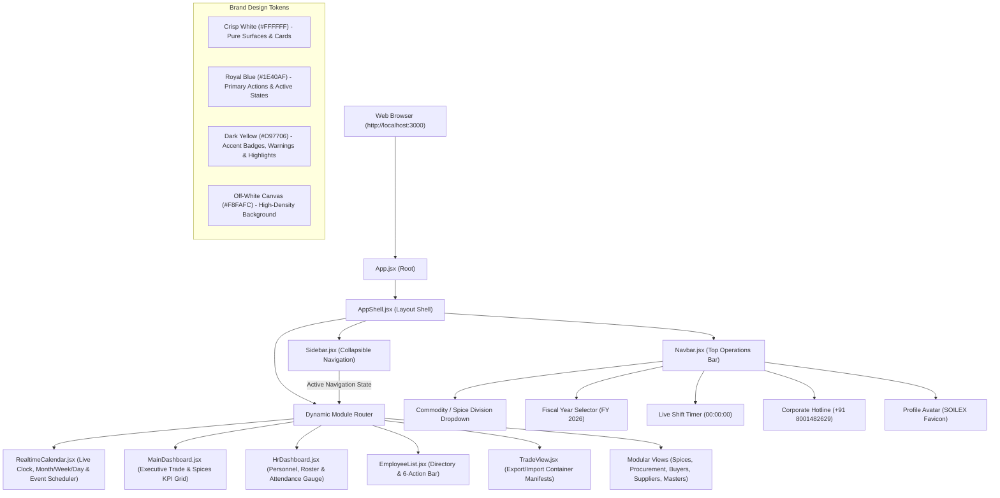

# SOILEX Life Science — Design Flow & Screen Customization Guide

Reference Website: **[https://soilexlifescience.com/](https://soilexlifescience.com/)**  
Tagline: *"The Essence of Authentic Spices"*  
Core Operations: Exporter of High-Quality Spices, Agro Commodities, Rice, Tea, and Feed Ingredients (ISO, HACCP, FSSAI Certified).

---

## 1. Application Architecture & Design Flow



---

## 2. Real-Time Calendar (`src/components/calendar/RealtimeCalendar.jsx`)

Based on your mockup in **`d:\IV\MY CALENDER\CALENDER.png`**, the real-time calendar includes:

### Key Features:
1. **Live Digital Clock & Date**: Ticks every second with real-time hours, minutes, and seconds.
2. **Month Navigation**: `<` and `>` arrow buttons, dynamic Month/Year title (e.g., `SEPTEMBER 2026`), and a **TODAY** button that instantly resets to the current date.
3. **View Modes**:
   * **`MONTH`**: The standard 7x6 month grid matching `CALENDER.png` with day numbers in top-right corners and soft yellow selected day highlight (`#FEFCE8` / `#FEF9C3`).
   * **`WEEK`**: 7-day hourly breakdown columns.
   * **`DAY`**: Single-day chronological agenda with event locations, time slots, and task deletion.
4. **Interactive Event Scheduling**:
   * Click **"+ ADD EVENT"** or click on any calendar cell to open the modal popup.
   * Add custom events with Title, Date, Time, Category (*Shipment, Quality Audit, Agro Sampling, Meeting*), Location, and Description.
   * Events render as color-coded badges directly inside the cell.
   * Click any event pill to view its complete details or delete it.

---

## 3. Brand Alignment with soilexlifescience.com

| Business Area | Website Offering | Corresponding ERP Module in `d:\IV` |
| :--- | :--- | :--- |
| **Whole Spices** | Anise Cigar, Pepper, Javitri, Nutmeg, Cardamom, Clove, Cinnamon | `Products/`, `Main/` (Contracts & Orders) |
| **Commodities & Grains** | Perfumed Rice (DT 8, Jasmine, Basmati), Indian Aromatic Tea (Dooars, Darjeeling) | `Products/`, `Export/` |
| **Animal Nutrition & Feed** | Rice DDGS, Corn DDGS, Soyabean Meal, Rapeseed Meal, Sunflower | `Products/`, `Import/` (Raw Material) |
| **Logistics & Trade** | Bulk & Containerized Exports (Pan-India & Global CBM/MT Shipping) | `Export/`, `Import/`, `Visits/` |
| **Quality & Compliance** | ISO, HACCP, FSSAI Certification Standards | `MASTERS/`, `User Management/` |
| **Workforce & Operations** | Management, Quality Control Labs, Bio-Hubs, Processing Plants | `EMPLOYEE/`, `Attendance/`, `payroll/` |
| **Operations Schedule** | Live Shipping Schedules, Port Loadings, Audits | `MY CALENDER/` -> `RealtimeCalendar.jsx` |

---

## 4. Screen-by-Screen Customization Guide

### Screen 1: Real-Time Calendar (`MY CALENDER/`)
* **File**: `src/components/calendar/RealtimeCalendar.jsx`
* **Mockup Reference**: `d:\IV\MY CALENDER\CALENDER.png`
* **Customization Points**:
  * **Initial Events Array (`events`)**: Add recurring corporate events, shipping windows, or executive reviews.
  * **Category Badges**:
    * `Shipment`: Blue (`bg-blue-100 text-[#1E40AF]`)
    * `Compliance / Audit`: Dark Yellow (`bg-amber-100 text-[#B45309]`)
    * `Agro / Milling`: Emerald Green (`bg-emerald-100 text-emerald-800`)
    * `Executive Meeting`: Purple (`bg-purple-100 text-purple-800`)

### Screen 2: Executive Trade Overview (`Main/`)
* **File**: `src/components/dashboard/MainDashboard.jsx`
* **Mockup Reference**: `d:\IV\Main\main page 1.png`

### Screen 3: Workforce & Attendance Dashboard (`HR Dashboard/`)
* **File**: `src/components/hr/HrDashboard.jsx`
* **Mockup Reference**: `d:\IV\HR Dashboard\HR.png`

### Screen 4: Employee Directory & Roster (`EMPLOYEE/`)
* **File**: `src/components/employees/EmployeeList.jsx`
* **Mockup Reference**: `d:\IV\EMPLOYEE\employee list.png`

### Screen 5: Container Manifests & Freight (`Export/` & `Import/`)
* **File**: `src/components/trade/TradeView.jsx`
* **Mockup Reference**: `d:\IV\Export\sales dashboard 1.png`

---

## 5. Live Development & Verification

* **Dev Server**: Running live on **[http://localhost:3000/](http://localhost:3000/)**
* **Instant Hot Reload (HMR)**: Any changes made to components update live in the browser.
* **Production Build**:
  ```powershell
  npm.cmd run build
  ```
