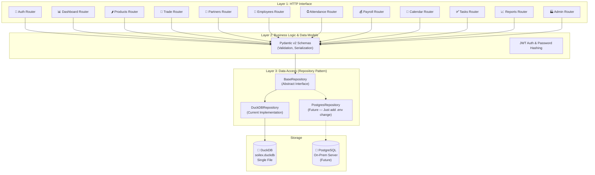
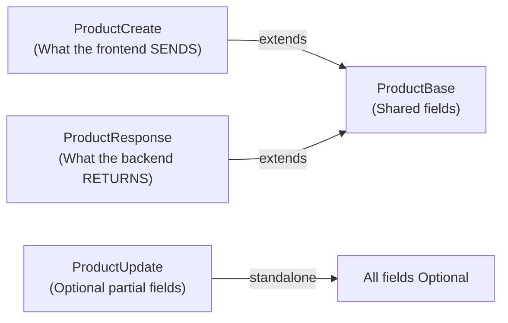
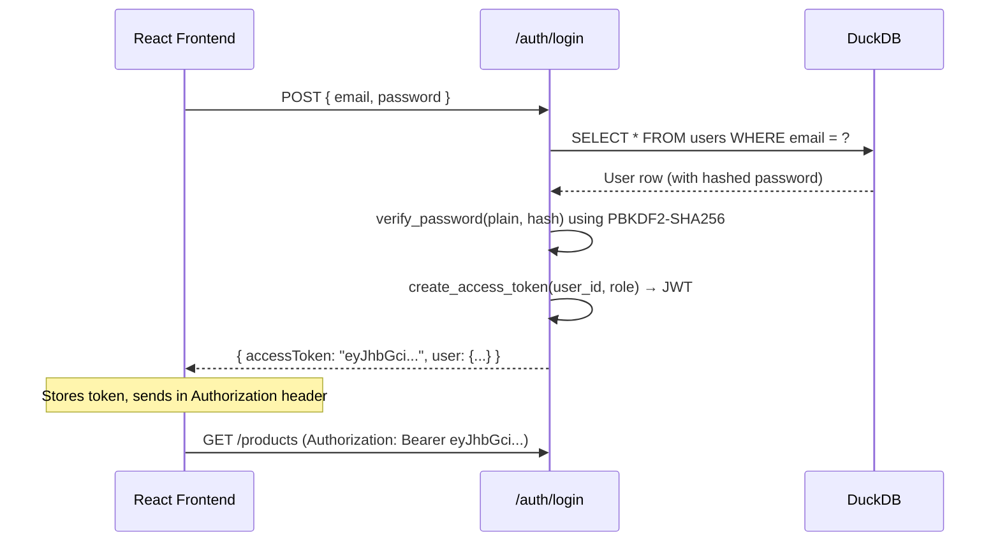
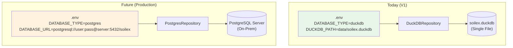
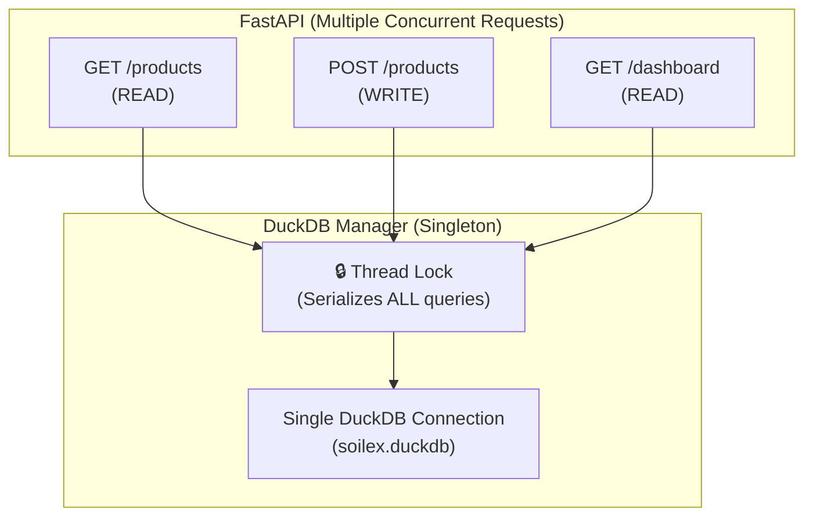
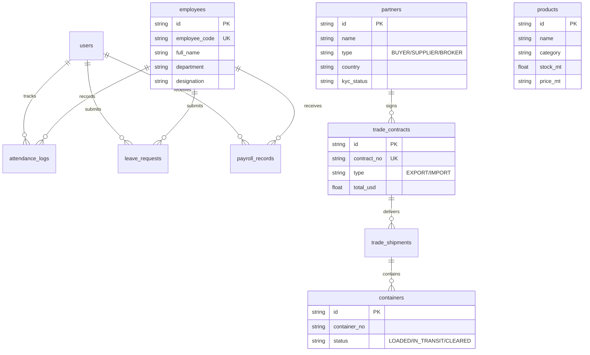
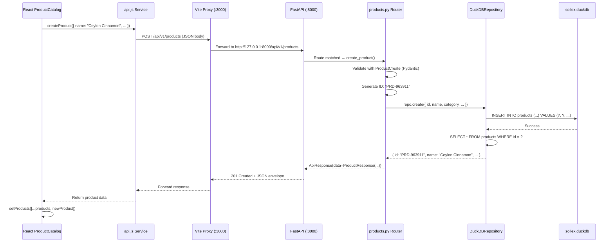

# SOILEX Life Science ERP — Backend Architecture Explained

## The Big Picture

The backend follows a **3-layer clean architecture** where each layer has one job and only talks to the layer directly below it. This means you can swap out any layer without breaking the others.



---

## Layer-by-Layer Breakdown

### Layer 1: FastAPI Routers (HTTP Interface)

These are the **12 API routers** that receive HTTP requests from your React frontend. Each router is a separate Python file handling one ERP module.

| Router File | Prefix | Endpoints | What It Does |
|---|---|---|---|
| [auth.py](file:///d:/IV/backend/app/api/v1/endpoints/auth.py) | `/auth` | `POST /login`, `GET /me` | JWT token login, user profile |
| [dashboard.py](file:///d:/IV/backend/app/api/v1/endpoints/dashboard.py) | `/dashboard` | `GET /executive-summary` | Aggregates live KPIs from all tables |
| [products.py](file:///d:/IV/backend/app/api/v1/endpoints/products.py) | `/products` | Full CRUD | Spices, Grains, Animal Feed catalog |
| [trade.py](file:///d:/IV/backend/app/api/v1/endpoints/trade.py) | `/trade` | Contracts, Shipments, Containers | Export/Import logistics & Bill of Lading |
| [partners.py](file:///d:/IV/backend/app/api/v1/endpoints/partners.py) | `/partners` | CRUD + filter by type | Buyers, Suppliers, Brokers directory |
| [employees.py](file:///d:/IV/backend/app/api/v1/endpoints/employees.py) | `/employees` | CRUD + search | HR workforce directory |
| [attendance.py](file:///d:/IV/backend/app/api/v1/endpoints/attendance.py) | `/attendance` | Clock-in, Logs, Leaves | Biometric punch simulator & leave management |
| [payroll.py](file:///d:/IV/backend/app/api/v1/endpoints/payroll.py) | `/payroll` | Records, Generate | Monthly salary processing |
| [calendar.py](file:///d:/IV/backend/app/api/v1/endpoints/calendar.py) | `/calendar` | Events CRUD | Operational scheduling |
| [tasks.py](file:///d:/IV/backend/app/api/v1/endpoints/tasks.py) | `/tasks` | CRUD + Toggle | My Day / workspace planner |
| [reports.py](file:///d:/IV/backend/app/api/v1/endpoints/reports.py) | `/reports` | Revenue, Audit logs | YTD analytics & transaction audit trail |
| [admin.py](file:///d:/IV/backend/app/api/v1/endpoints/admin.py) | `/admin` | Facilities, System info | Bio-Hub sites & DB diagnostics |

All 12 routers are aggregated in [api.py](file:///d:/IV/backend/app/api/v1/api.py) and mounted under the `/api/v1` prefix.

---

### Layer 2: Pydantic Models & Security (Business Logic)

#### Standard API Envelope

Every response follows a consistent envelope defined in [common.py](file:///d:/IV/backend/app/models/common.py):

```json
{
  "success": true,
  "statusCode": 200,
  "message": "Retrieved 8 commodity products",
  "data": [ ... ],
  "timestamp": "2026-09-05T15:12:00Z"
}
```

This makes the frontend predictable — it always checks `response.data` for the payload.

#### Pydantic v2 Schema Layering

Each module has a **three-class pattern**:



- **`ProductCreate`** — Used for POST requests. Has all required fields validated.
- **`ProductUpdate`** — Used for PUT/PATCH. All fields are `Optional` so you can update just one column.
- **`ProductResponse`** — Used for GET. Adds `id` and `created_at` to the base fields.

#### JWT Security ([security.py](file:///d:/IV/backend/app/core/security.py))



Passwords are hashed using **PBKDF2-HMAC-SHA256** with random salt (not plain bcrypt, which had compatibility issues with Python 3.12). JWTs are signed with HS256.

---

### Layer 3: Repository Pattern (The Migration Magic)

This is the **most important design decision** in the entire backend. Here's why:

#### The Problem
You want to use DuckDB now (zero setup, single file, fast analytics), but later you might move to PostgreSQL on a production server. Without an abstraction, you'd have to rewrite every single database call in every router.

#### The Solution: Abstract Repository Interface

[base.py](file:///d:/IV/backend/app/repositories/base.py) defines a contract:

```python
class BaseRepository(ABC):
    def get_all(filters, limit, offset) → List[Dict]
    def get_by_id(id) → Dict | None
    def create(data) → Dict
    def update(id, data) → Dict
    def delete(id) → bool
    def count(filters) → int
```

[duckdb_repo.py](file:///d:/IV/backend/app/repositories/duckdb_repo.py) implements this with DuckDB SQL:

```python
class DuckDBRepository(BaseRepository):
    def __init__(self, table_name):
        self.table_name = table_name  # e.g. "products"
    
    def get_all(self, filters):
        sql = f"SELECT * FROM {self.table_name} WHERE ..."
        return db_manager.execute_query(sql, params)
```

The [factory](file:///d:/IV/backend/app/repositories/__init__.py) selects the right implementation based on config:

```python
def get_repository(table_name) → BaseRepository:
    if settings.DATABASE_TYPE == "duckdb":
        return DuckDBRepository(table_name)
    elif settings.DATABASE_TYPE == "postgres":
        return PostgresRepository(table_name)  # Future
```

#### How Migration Works



> [!IMPORTANT]
> **Zero code changes required.** You only edit the `.env` file. All 12 routers, all Pydantic models, all the frontend API calls — everything stays exactly the same.

---

## DuckDB Connection Manager

DuckDB is an **in-process** database (no external server). But it has a limitation: only **one writer at a time**. FastAPI handles multiple concurrent requests, so we need thread safety.

[database.py](file:///d:/IV/backend/app/core/database.py) solves this:



- `execute_query()` — For SELECTs (returns list of dicts)
- `execute_write()` — For INSERT/UPDATE/DELETE (acquires lock)
- `execute_script()` — For multi-statement DDL (schema creation)

---

## Database Schema (13 Tables)



---

## Request Flow: End-to-End Example

Here's what happens when you click **"Add Product"** in the React UI:



---

## File-to-Layer Mapping

| File | Layer | Purpose |
|------|-------|---------|
| [main.py](file:///d:/IV/backend/app/main.py) | Entry Point | Creates FastAPI app, CORS, startup hook |
| [config.py](file:///d:/IV/backend/app/core/config.py) | Configuration | DB paths, JWT secret, CORS origins |
| [security.py](file:///d:/IV/backend/app/core/security.py) | Security | Password hashing, JWT creation/decode |
| [database.py](file:///d:/IV/backend/app/core/database.py) | Infrastructure | Thread-safe DuckDB connection singleton |
| [schema_migration.py](file:///d:/IV/backend/app/db/schema_migration.py) | Database | CREATE TABLE DDL for all 13 tables |
| [seed_data.py](file:///d:/IV/backend/app/db/seed_data.py) | Database | Pre-populates tables with SOILEX data |
| [common.py](file:///d:/IV/backend/app/models/common.py) | Models | Standard `ApiResponse[T]` envelope |
| [product.py](file:///d:/IV/backend/app/models/product.py) | Models | Create/Update/Response schemas |
| [base.py](file:///d:/IV/backend/app/repositories/base.py) | Repository | Abstract interface (6 methods) |
| [duckdb_repo.py](file:///d:/IV/backend/app/repositories/duckdb_repo.py) | Repository | SQL implementation using DuckDB |
| [products.py](file:///d:/IV/backend/app/api/v1/endpoints/products.py) | Router | GET/POST/PUT/DELETE /products |
| [api.py](file:///d:/IV/backend/app/api/v1/api.py) | Router | Mounts all 12 sub-routers |
| [api.js](file:///d:/IV/src/services/api.js) | Frontend | Fetch client with fail-safe fallback |

---

## Key Design Decisions Summary

| Decision | Why |
|----------|-----|
| **DuckDB over SQLite** | Columnar engine = fast analytical aggregations for trade KPIs (\$7M YTD, 20K CBM). SQLite would struggle with these. |
| **Repository Pattern** | Decouples SQL from routes. One `.env` change swaps DuckDB → PostgreSQL. |
| **Thread Lock on writes** | DuckDB only allows 1 writer. The lock prevents file corruption under concurrent FastAPI requests. |
| **PBKDF2 over bcrypt** | bcrypt 5.0 has compatibility issues with `passlib` on Python 3.12. PBKDF2-SHA256 with random salt is equally secure and stdlib-compatible. |
| **Pydantic v2** | 17× faster validation than v1. `Union[datetime, str]` handles DuckDB returning native datetime objects. |
| **Vite proxy** | Avoids CORS issues in dev. Frontend calls `/api/v1/...` → Vite forwards to `:8000`. |
| **Fail-safe API client** | If backend is offline, React components fall back to local mock data. The UI never breaks. |
