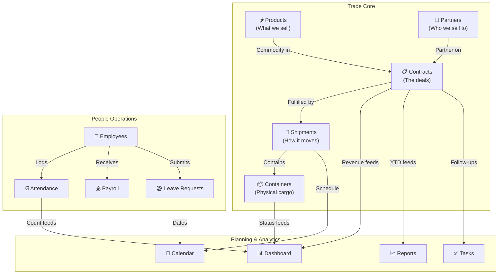

# End-to-End ERP Integration Roadmap

## Where We Stand Today

### What's Built

| Layer | Status | Detail |
|-------|--------|--------|
| **Frontend** | ✅ 15 components, 12 modules | All UI rendering with hardcoded mock data |
| **Backend** | ✅ 12 routers, 28 endpoints | Full CRUD APIs with DuckDB |
| **API Client** | ✅ [api.js](file:///d:/IV/src/services/api.js) | Methods for all 12 modules |
| **Database** | ✅ 13 tables, seeded | Authentic SOILEX data |

### Integration Status Per Module

```
 Module                     Frontend  Backend  Wired?   Priority
 ─────────────────────────  ────────  ───────  ───────  ────────
 Dashboard (MainDashboard)  ✅        ✅       🟡 Partial  —
 Products (ProductCatalog)  ✅        ✅       🟡 Partial  —
 Calendar (RealtimeCalendar)✅        ✅       🟡 Import   —
 ─────────────────────────  ────────  ───────  ───────  ────────
 Trade (TradeView)          ✅        ✅       ❌ No       Phase 1
 Partners (PartnersView)    ✅        ✅       ❌ No       Phase 1
 Employees (EmployeeList)   ✅        ✅       ❌ No       Phase 2
 HR Dashboard (HrDashboard) ✅        ✅       ❌ No       Phase 2
 Attendance (AttendanceView)✅        ✅       ❌ No       Phase 2
 Payroll (PayrollView)      ✅        ✅       ❌ No       Phase 3
 Tasks (TodoPlanner)        ✅        ✅       ❌ No       Phase 3
 Reports (ReportsView)      ✅        ✅       ❌ No       Phase 3
 Admin (MastersAdminView)   ✅        ✅       ❌ No       Phase 4
 Auth (Login Page)          ❌ None   ✅       ❌ No       Phase 4
```

**3 out of 12 modules partially wired.** The api.js service already has all the method stubs — the work is wiring each component's `useState` → `useEffect` → `api.method()`.

---

## Proposed Integration Phases

### Phase 1: Core Trade Operations (Revenue-Critical Path)

> [!IMPORTANT]
> This is the **money path** — the modules that track actual export revenue, contracts, and business partners. Should be done first.

#### [WIRE] [TradeView.jsx](file:///d:/IV/src/components/trade/TradeView.jsx) → Backend
- **Current**: 140 lines, hardcoded contracts/shipments/containers
- **Wire to**: `api.getContracts()`, `api.getShipments()`, `api.getContainers()`
- **Add**: Create contract form → `api.createContract()`
- **Add**: Container status updates → `api.updateContainerStatus()`
- **Cross-module link**: When creating a contract, select partner from Partners API and commodity from Products API

#### [WIRE] [PartnersView.jsx](file:///d:/IV/src/components/partners/PartnersView.jsx) → Backend
- **Current**: 187 lines, hardcoded buyer/supplier/broker tabs
- **Wire to**: `api.getPartners(type)`, `api.createPartner()`
- **Add**: Delete partner → `api.deletePartner(id)`
- **Cross-module link**: Partner detail should show their active contracts from Trade API

#### [COMPLETE] Dashboard & Products Integration
- **Dashboard**: Wire remaining 6 KPI cards (Contracts YTD, Invoices, Purchase volume, Containers) to live aggregations
- **Products**: Add Edit and Delete buttons wired to `api.updateProduct()` and `api.deleteProduct()`

---

### Phase 2: Workforce & HR (People Operations)

#### [WIRE] [EmployeeList.jsx](file:///d:/IV/src/components/employees/EmployeeList.jsx) → Backend
- **Current**: 232 lines, hardcoded employee table with 6-action buttons
- **Wire to**: `api.getEmployees(department, search)`, `api.createEmployee()`
- **Add**: Department/branch filter dropdowns populated from backend data
- **Cross-module link**: Employee ID links to their attendance logs and payroll records

#### [WIRE] [HrDashboard.jsx](file:///d:/IV/src/components/hr/HrDashboard.jsx) → Backend
- **Current**: 218 lines, employee profile card + attendance gauge + pending leaves
- **Wire to**: Mix of `api.getEmployees()`, `api.getAttendanceLogs(today)`, `api.getLeaveRequests()`
- **Add**: Aggregate present/absent/leave counts for the donut chart from live attendance data

#### [WIRE] [AttendanceView.jsx](file:///d:/IV/src/components/attendance/AttendanceView.jsx) → Backend
- **Current**: 202 lines, biometric simulator + leave application modal
- **Wire to**: `api.getAttendanceLogs(date)`, `api.clockIn()`, `api.getLeaveRequests()`, `api.submitLeaveRequest()`
- **This is the most interactive module** — clock-in should POST to backend and immediately refresh the log table

---

### Phase 3: Operations & Analytics

#### [WIRE] [PayrollView.jsx](file:///d:/IV/src/components/payroll/PayrollView.jsx) → Backend
- **Current**: 149 lines, salary slip table
- **Wire to**: `api.getPayrollRecords(monthYear)`, `api.generatePayroll(monthYear)`
- **Add**: "Generate Monthly Payroll" button that POSTs to backend and populates records for all employees

#### [WIRE] [TodoPlanner.jsx](file:///d:/IV/src/components/workspace/TodoPlanner.jsx) → Backend
- **Current**: 247 lines, task cards with priority queues
- **Wire to**: `api.getTasks()`, `api.createTask()`, `api.toggleTask(id)`, `api.deleteTask(id)`
- **Add**: Real persistence — tasks survive page refreshes

#### [WIRE] [ReportsView.jsx](file:///d:/IV/src/components/analytics/ReportsView.jsx) → Backend
- **Current**: 156 lines, revenue analytics + audit logs
- **Wire to**: `api.getExportRevenueAnalytics()`, `api.getAuditLogs()`
- **Cross-module link**: Revenue figures should reflect actual trade contract totals from DuckDB

#### [WIRE] [RealtimeCalendar.jsx](file:///d:/IV/src/components/calendar/RealtimeCalendar.jsx) → Backend
- **Current**: 703 lines (largest component), partially imported API
- **Complete**: Merge backend events into the local event list via `api.getCalendarEvents()`
- **Add**: New events POST to `api.createCalendarEvent()` so they persist

---

### Phase 4: Security, Admin & Auth Flow

#### [NEW] Login Page Component
- **Create**: `src/components/auth/LoginPage.jsx`
- **Flow**: Email + password form → `api.login()` → store JWT token → redirect to dashboard
- **Store token**: `localStorage` or React context
- **Auto-apply**: `api.setToken(storedToken)` on app load

#### [NEW] Auth Context & Protected Routes
- **Create**: `src/context/AuthContext.jsx`
- **Wrap**: `<AuthProvider>` around `<AppShell>`
- **Guard**: If no token, show LoginPage instead of AppShell
- **Role display**: Show user name + role in Navbar from `api.getProfile()`

#### [WIRE] [MastersAdminView.jsx](file:///d:/IV/src/components/admin/MastersAdminView.jsx) → Backend
- **Wire to**: `api.getFacilities()`, `api.getSystemInfo()`
- **Add**: Show live database diagnostics (table counts, DB size, migration readiness)

---

## Cross-Module Data Flows

Once all modules are wired, these **cross-module relationships** make the ERP truly integrated:



> [!TIP]
> **The real power of the ERP** comes from these links. For example:
> - Creating a new **Contract** should auto-populate the commodity from the **Products** catalog and the buyer from the **Partners** directory
> - Approving a **Leave Request** should update the **Attendance** log for those dates and appear on the **Calendar**
> - Completing a **Shipment** should update the **Container** statuses and refresh the **Dashboard** KPIs

---

## The Wiring Pattern (How Each Module Gets Connected)

Every module follows the same 4-step pattern:

```jsx
// Step 1: Import the API service
import api from '../../services/api';

// Step 2: Replace useState(hardcodedData) with useState([])
const [items, setItems] = useState([]);

// Step 3: Fetch on mount with fallback
useEffect(() => {
  api.getItems().then(data => {
    if (data && data.length > 0) {
      setItems(data.map(mapBackendToFrontend));
    } else {
      setItems(FALLBACK_DATA); // Keep hardcoded as fallback
    }
  });
}, []);

// Step 4: Wire mutations (create/update/delete) to API
const handleCreate = async (newItem) => {
  const result = await api.createItem(newItem);
  if (result) setItems([...items, result]);
};
```

This pattern:
- ✅ Keeps the UI working even if backend is offline (fallback)
- ✅ No breaking changes — existing mock data stays as default
- ✅ Each module can be wired independently

---

## Open Questions

> [!IMPORTANT]
> **Integration depth**: Should I wire all 12 modules in one go (comprehensive but longer), or would you prefer to go phase by phase so you can test and customize each module before moving on?

> [!NOTE]
> **New backend features needed for full integration**:
> 1. **Cross-module queries**: e.g., `GET /employees/{id}/attendance` to get an employee's attendance history
> 2. **Aggregation endpoints**: e.g., `GET /dashboard/hr-summary` for the HR Dashboard's donut chart data
> 3. **Batch operations**: e.g., `POST /payroll/generate` already exists, but we may need `POST /attendance/bulk-import`
> 4. **File generation**: PDF salary slips, CSV exports — do you want these in V1?
>
> Should I add these backend endpoints as part of the integration, or keep V1 focused on the basic CRUD wiring?

---

## Estimated Effort

| Phase | Modules | Frontend Changes | Backend Changes | Effort |
|-------|---------|-----------------|-----------------|--------|
| **Phase 1** | Trade, Partners, Dashboard, Products | 4 components wired | 0 new endpoints | ~1 session |
| **Phase 2** | Employees, HR Dashboard, Attendance | 3 components wired | 1-2 aggregation endpoints | ~1 session |
| **Phase 3** | Payroll, Tasks, Reports, Calendar | 4 components wired | 0 new endpoints | ~1 session |
| **Phase 4** | Login, Auth Context, Admin | 2 new + 1 wired | 0 new endpoints | ~1 session |
| **Total** | 12 modules + auth | 14 component changes | 1-2 new endpoints | ~4 sessions |

After all 4 phases, you'll have a **fully functional, end-to-end ERP** where every create/edit/delete persists in DuckDB, every table loads live data, and users log in with JWT authentication.
