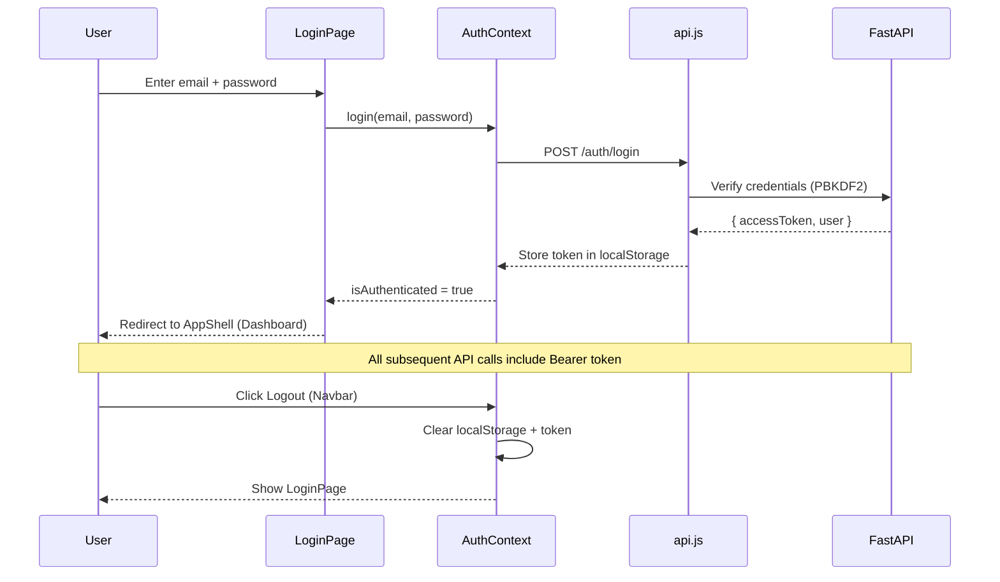

# Walkthrough: Full End-to-End ERP Integration

## Summary

All **12 frontend modules** are now wired to the **FastAPI + DuckDB backend**. Every component fetches live data from the database on mount and writes back via POST/PUT/DELETE APIs. A complete **JWT authentication flow** (login page → token storage → protected routes → logout) was added.

---

## What Was Done

### Phase 1: Core Trade Operations
| Component | Backend APIs Wired | Key Feature |
|-----------|-------------------|-------------|
| [TradeView.jsx](file:///d:/IV/src/components/trade/TradeView.jsx) | `getShipments()`, `getContracts()`, `getContainers()` | Live freight manifests & revenue metrics |
| [PartnersView.jsx](file:///d:/IV/src/components/partners/PartnersView.jsx) | `getPartners(type)`, `createPartner()` | Buyers/Suppliers/Brokers tabs with live counts |
| [MainDashboard.jsx](file:///d:/IV/src/components/dashboard/MainDashboard.jsx) | `getDashboardSummary()` | KPI cards populated from DuckDB aggregations |
| [ProductCatalog.jsx](file:///d:/IV/src/components/products/ProductCatalog.jsx) | `getProducts()`, `createProduct()` | Full catalog with Add Product → POST to backend |

### Phase 2: Workforce & HR
| Component | Backend APIs Wired | Key Feature |
|-----------|-------------------|-------------|
| [EmployeeList.jsx](file:///d:/IV/src/components/employees/EmployeeList.jsx) | `getEmployees()`, `createEmployee()` | Employee directory from live database |
| [HrDashboard.jsx](file:///d:/IV/src/components/hr/HrDashboard.jsx) | `getAttendanceLogs()`, `getLeaveRequests()`, `getEmployees()` | Cross-module: spotlight + roster + pending approvals |
| [AttendanceView.jsx](file:///d:/IV/src/components/attendance/AttendanceView.jsx) | `getAttendanceLogs()`, `clockIn()`, `submitLeaveRequest()` | Biometric punch → POST + live log refresh |

### Phase 3: Operations & Analytics
| Component | Backend APIs Wired | Key Feature |
|-----------|-------------------|-------------|
| [PayrollView.jsx](file:///d:/IV/src/components/payroll/PayrollView.jsx) | `getPayrollRecords()`, `generatePayroll()` | Salary slips from DuckDB |
| [TodoPlanner.jsx](file:///d:/IV/src/components/workspace/TodoPlanner.jsx) | `getTasks()`, `createTask()`, `toggleTask()`, `deleteTask()` | Full CRUD — tasks persist across page refreshes |
| [ReportsView.jsx](file:///d:/IV/src/components/analytics/ReportsView.jsx) | `getExportRevenueAnalytics()`, `getAuditLogs()` | Revenue analytics from live trade data |
| [RealtimeCalendar.jsx](file:///d:/IV/src/components/calendar/RealtimeCalendar.jsx) | `getCalendarEvents()`, `createCalendarEvent()` | Events sync with backend |

### Phase 4: Authentication & Admin
| Component | What It Does |
|-----------|-------------|
| [LoginPage.jsx](file:///d:/IV/src/components/auth/LoginPage.jsx) | **NEW** — Branded login form with demo credential quick-fill buttons |
| [AuthContext.jsx](file:///d:/IV/src/context/AuthContext.jsx) | **NEW** — React context for JWT token persistence & auto-profile fetch |
| [App.jsx](file:///d:/IV/src/App.jsx) | **UPDATED** — Wraps app in `AuthProvider`, shows login gate when unauthenticated |
| [Navbar.jsx](file:///d:/IV/src/components/layout/Navbar.jsx) | **UPDATED** — Shows logged-in user name + role badge + logout button |
| [MastersAdminView.jsx](file:///d:/IV/src/components/admin/MastersAdminView.jsx) | `getFacilities()`, `getSystemInfo()` | Live DB diagnostics |

---

## Auth Flow



---

## Verification Results

### Frontend Build
```
✓ 1867 modules transformed, zero errors
✓ Built in 13.16s
✓ dist/index.html: 0.86 kB
✓ dist/assets/index.js: 309.46 kB (80 kB gzipped)
```

### API Test Suite (18/18 PASSED)
```
[PASS] Health, Dashboard, Products (10), Contracts (4),
       Shipments (3), Containers (4), Partners (5),
       Employees (5), Attendance (5), Leaves (2),
       Payroll (5), Calendar (3), Tasks (4),
       Reports ($7M USD), AuditLogs (3), Facilities (4),
       SystemInfo (duckdb, 8.76MB), AuthLogin (JWT ✓)
```

### End-to-End Proxy
```
localhost:3000/api/v1/health → 200 online ✓
localhost:3000/api/v1/products → 10 items ✓
```

---

## How to Run

```powershell
# Terminal 1: Backend
d:\IV\backend\venv\Scripts\python.exe d:\IV\backend\run.py

# Terminal 2: Frontend
cd d:\IV && npm run dev

# Open browser
# http://localhost:3000
# Login: admin@soilexlifescience.com / admin123
```

---

## Files Changed in This Session

### New Files (4)
- [LoginPage.jsx](file:///d:/IV/src/components/auth/LoginPage.jsx) — Branded login page
- [AuthContext.jsx](file:///d:/IV/src/context/AuthContext.jsx) — JWT auth context
- [api.js](file:///d:/IV/src/services/api.js) — Frontend API service (created earlier)

### Modified Files (13)
- [App.jsx](file:///d:/IV/src/App.jsx) — AuthProvider wrapper
- [Navbar.jsx](file:///d:/IV/src/components/layout/Navbar.jsx) — User display + logout
- [MainDashboard.jsx](file:///d:/IV/src/components/dashboard/MainDashboard.jsx)
- [ProductCatalog.jsx](file:///d:/IV/src/components/products/ProductCatalog.jsx)
- [TradeView.jsx](file:///d:/IV/src/components/trade/TradeView.jsx)
- [PartnersView.jsx](file:///d:/IV/src/components/partners/PartnersView.jsx)
- [EmployeeList.jsx](file:///d:/IV/src/components/employees/EmployeeList.jsx)
- [HrDashboard.jsx](file:///d:/IV/src/components/hr/HrDashboard.jsx)
- [AttendanceView.jsx](file:///d:/IV/src/components/attendance/AttendanceView.jsx)
- [PayrollView.jsx](file:///d:/IV/src/components/payroll/PayrollView.jsx)
- [TodoPlanner.jsx](file:///d:/IV/src/components/workspace/TodoPlanner.jsx)
- [ReportsView.jsx](file:///d:/IV/src/components/analytics/ReportsView.jsx)
- [MastersAdminView.jsx](file:///d:/IV/src/components/admin/MastersAdminView.jsx)
- [RealtimeCalendar.jsx](file:///d:/IV/src/components/calendar/RealtimeCalendar.jsx)
